# Canva

[Download full installer package / Baixar pacote completo](../../AJAZZ_AKP03E_v1.1.zip) · [Installation / Instalação](../../INSTALL.md) · [Profile / Perfil](Profile.SDProfile)

Saved configuration / Configuração gravada. Not hardware-tested / Sem teste físico.

Local program associations and audio devices must be selected again after import. / Selecione novamente os aplicativos e dispositivos de áudio após importar.

## Controls / Controles

| Page / Página | Position / Posição | Label / Rótulo | Saved command / Comando salvo |
|---|---|---|---|
| root | 0,0 | Texto | T  /  (empty)  /  (empty) |
| root | 0,1 | Copiar | Ctrl+Shift+C  /  (empty)  /  (empty) |
| root | 1,0 | Busca Mágica | OEM_2  /  (empty)  /  (empty) |
| root | 1,1 | Colar | Ctrl+V  /  (empty)  /  (empty) |
| root | 2,0 | Cam. à Frente | Ctrl+OEM_6  /  (empty)  /  (empty) |
| root | 2,1 | Cam. Atrás | Ctrl+OEM_4  /  (empty)  /  (empty) |
| root | 3,0 | Zoom | Ctrl+F12  /  Ctrl+F11  /  Ctrl+Alt+0 |
| root | 3,1 | Rolar Y | Ctrl+F9  /  Ctrl+F10  /  Shift+R |
| root | 4,1 | Rolar X | Ctrl+F7  /  Ctrl+F8  /  Ctrl+Enter |
| root | 5,0 | Desfazer | Ctrl+Z  /  (empty)  /  (empty) |
| root | 5,1 | Excluir | Delete  /  (empty)  /  (empty) |
| root | 5,2 | Refazer | Ctrl+Shift+Z  /  (empty)  /  (empty) |

## Screenshots / Capturas de tela

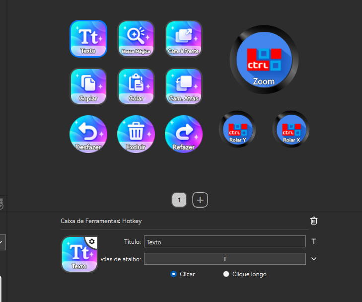

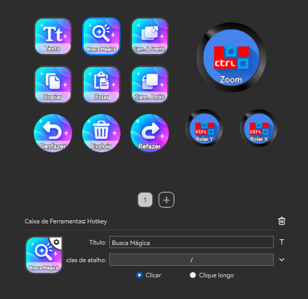

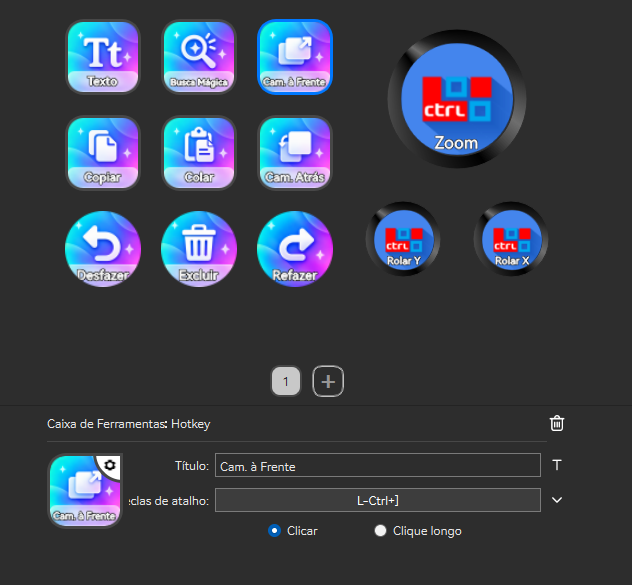

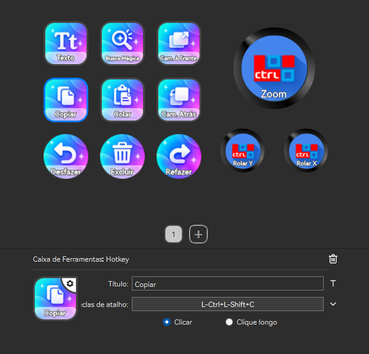

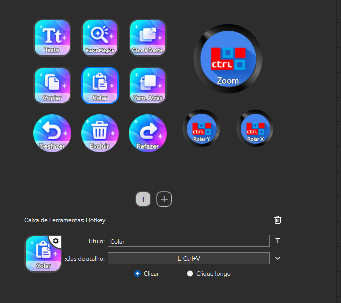

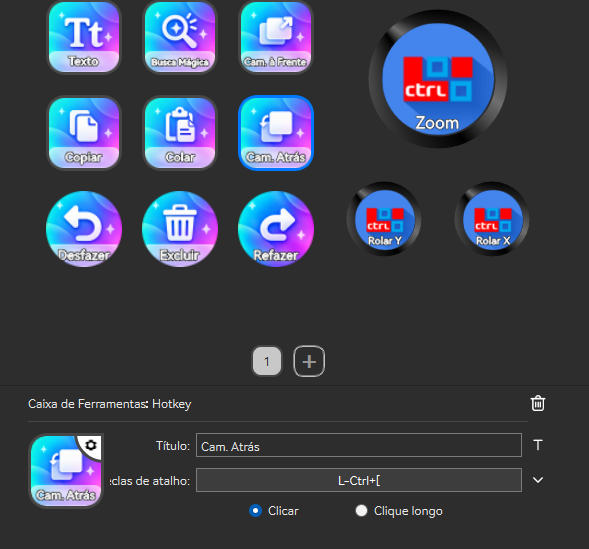

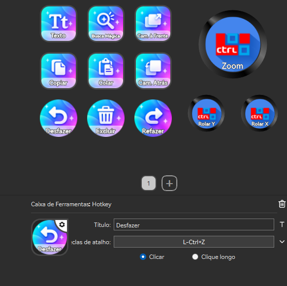

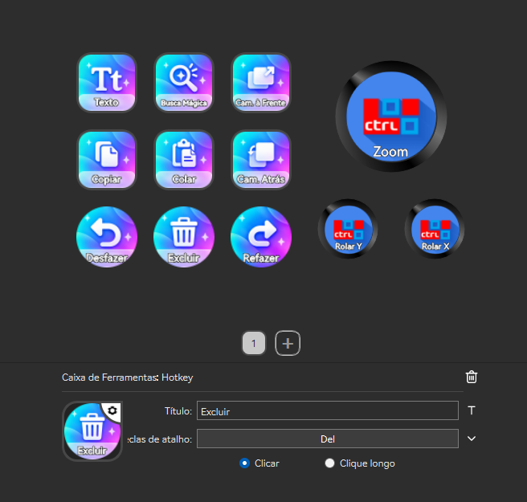

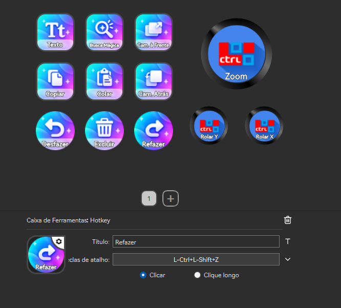

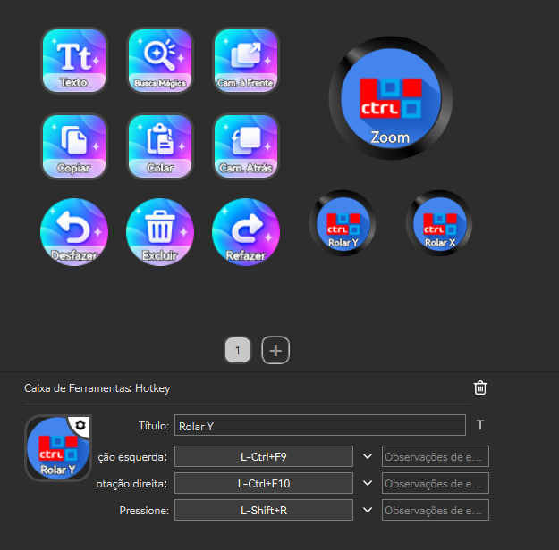

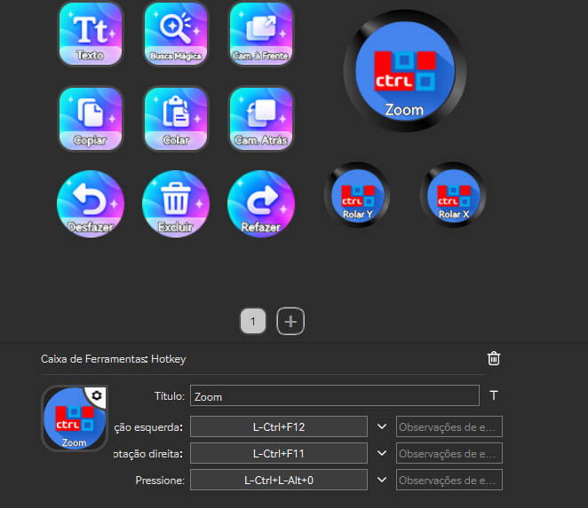

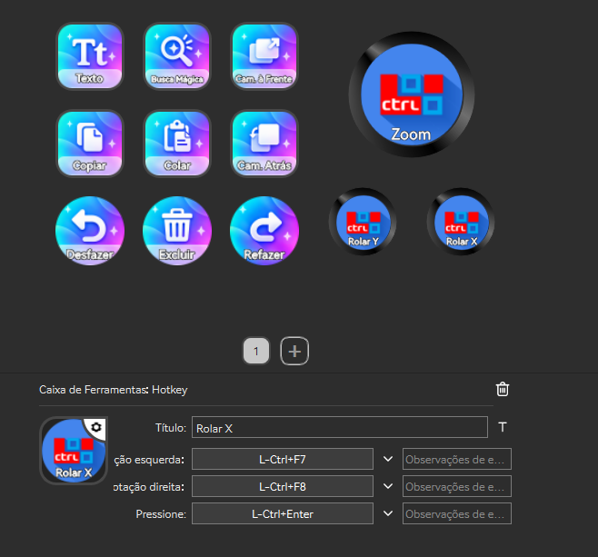
