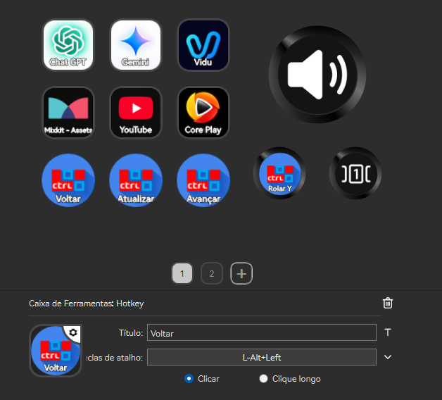
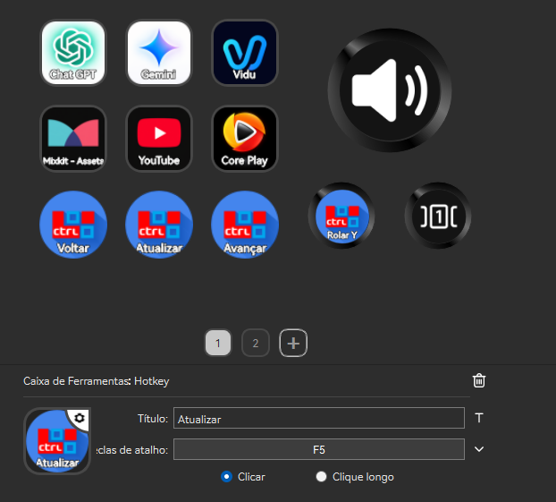
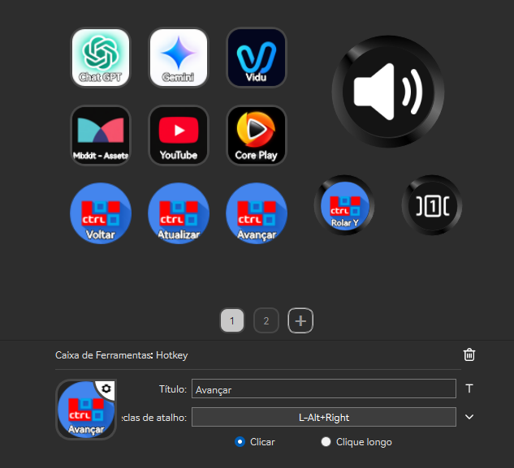
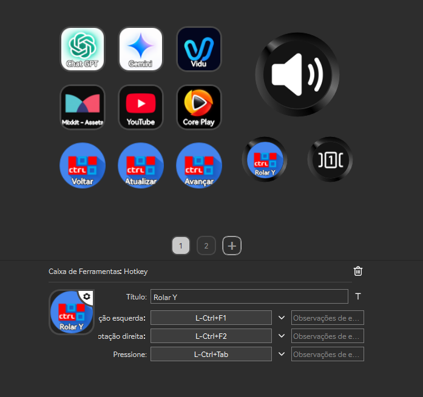
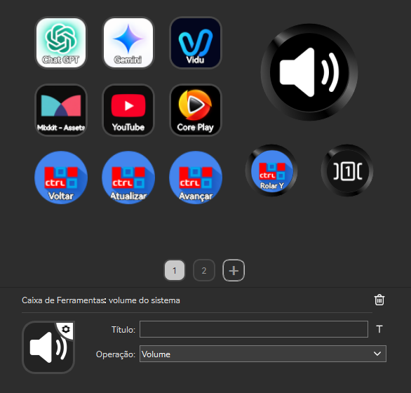
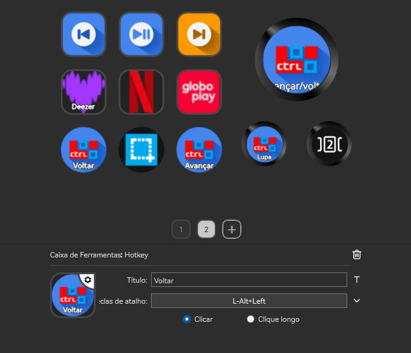
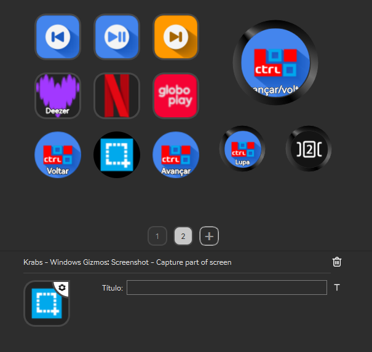
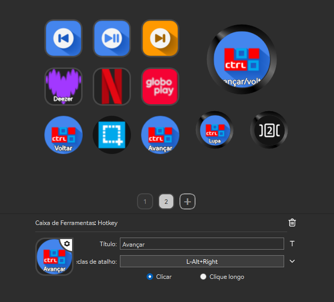
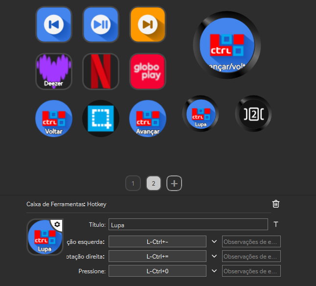
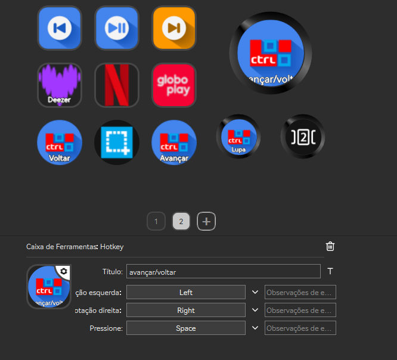

# Chrome

[Download full installer package / Baixar pacote completo](../../AJAZZ_AKP03E_v1.1.zip) · [Installation / Instalação](../../INSTALL.md) · [Profile / Perfil](Profile.SDProfile)

Saved configuration / Configuração gravada. Not hardware-tested / Sem teste físico.

Local program associations and audio devices must be selected again after import. / Selecione novamente os aplicativos e dispositivos de áudio após importar.

## Controls / Controles

| Page / Página | Position / Posição | Label / Rótulo | Saved command / Comando salvo |
|---|---|---|---|
| root | 0,0 | Chat GPT | appId=40; zero-based candidate: ChatGPT; target=OpenAI.Codex_2p2nqsd0c76g0!App |
| root | 0,1 | Mixkit - Assets | {"browser": "", "openInBrowser": true, "path": "https://mixkit.co/"} |
| root | 1,0 | Gemini | {"browser": "", "openInBrowser": true, "path": "https://gemini.google.com/app?hl=pt-BR"} |
| root | 1,1 | YouTube | {"browser": "", "openInBrowser": true, "path": "https://www.youtube.com/"} |
| root | 2,0 | Vidu | {"browser": "", "openInBrowser": true, "path": "https://www.vidu.com/pt/create/video-edit"} |
| root | 2,1 | Core Play | {"browser": "", "openInBrowser": true, "path": "http://corenatela.com/"} |
| root | 3,0 |  | {"actionIdx": 0} |
| root | 3,1 | Rolar Y | Ctrl+F1  /  Ctrl+F2  /  Ctrl+Tab |
| root | 4,1 |  | {} |
| root | 5,0 | Voltar | Alt+Left  /  (empty)  /  (empty) |
| root | 5,1 | Atualizar | F5  /  (empty)  /  (empty) |
| root | 5,2 | Avançar | Alt+Right  /  (empty)  /  (empty) |
| 38453XU0-900B-2A74-4D1B-2Z94ZS1497XJ.sdProfile | 0,0 |  | {"actionIdx": 0} |
| 38453XU0-900B-2A74-4D1B-2Z94ZS1497XJ.sdProfile | 0,1 | Deezer | {"browser": "", "openInBrowser": true, "path": "www.deezer.com"} |
| 38453XU0-900B-2A74-4D1B-2Z94ZS1497XJ.sdProfile | 1,0 |  | {"actionIdx": 1} |
| 38453XU0-900B-2A74-4D1B-2Z94ZS1497XJ.sdProfile | 1,1 |  | {"browser": "", "openInBrowser": true, "path": "netflix.com"} |
| 38453XU0-900B-2A74-4D1B-2Z94ZS1497XJ.sdProfile | 2,0 |  | {"actionIdx": 2} |
| 38453XU0-900B-2A74-4D1B-2Z94ZS1497XJ.sdProfile | 2,1 |  | {"browser": "", "openInBrowser": true, "path": "https://globoplay.globo.com/"} |
| 38453XU0-900B-2A74-4D1B-2Z94ZS1497XJ.sdProfile | 3,0 | avançar/voltar | Left  /  Right  /  Space |
| 38453XU0-900B-2A74-4D1B-2Z94ZS1497XJ.sdProfile | 3,1 | Lupa | Ctrl+OEM_MINUS  /  Ctrl+OEM_PLUS  /  Ctrl+0 |
| 38453XU0-900B-2A74-4D1B-2Z94ZS1497XJ.sdProfile | 4,1 |  | {} |
| 38453XU0-900B-2A74-4D1B-2Z94ZS1497XJ.sdProfile | 5,0 | Voltar | Alt+Left  /  (empty)  /  (empty) |
| 38453XU0-900B-2A74-4D1B-2Z94ZS1497XJ.sdProfile | 5,1 |  | {} |
| 38453XU0-900B-2A74-4D1B-2Z94ZS1497XJ.sdProfile | 5,2 | Avançar | Alt+Right  /  (empty)  /  (empty) |

## Screenshots / Capturas de tela

