# DaVinci Resolve

[Download full installer package / Baixar pacote completo](../../AJAZZ_AKP03E_v1.1.zip) · [Installation / Instalação](../../INSTALL.md) · [Profile / Perfil](Profile.SDProfile)

Saved configuration / Configuração gravada. Not hardware-tested / Sem teste físico.

Local program associations and audio devices must be selected again after import. / Selecione novamente os aplicativos e dispositivos de áudio após importar.

## Controls / Controles

| Page / Página | Position / Posição | Label / Rótulo | Saved command / Comando salvo |
|---|---|---|---|
| root | 0,0 | Seleção | A  /  (empty)  /  (empty) |
| root | 0,1 | Copiar | Ctrl+C  /  (empty)  /  (empty) |
| root | 1,0 | Lâmina | B  /  (empty)  /  (empty) |
| root | 1,1 | Colar | Ctrl+V  /  (empty)  /  (empty) |
| root | 2,0 | Cortar | Ctrl+B  /  (empty)  /  (empty) |
| root | 2,1 | Excluir | Backspace  /  (empty)  /  (empty) |
| root | 3,0 | <<play>> | Left  /  Right  /  Space |
| root | 3,1 | zoom | Ctrl+F5  /  Ctrl+F4  /  Shift+Z |
| root | 4,1 | scroll | Ctrl+F7  /  Ctrl+F8  /  Ctrl+F |
| root | 5,0 | Desfazer | Ctrl+Z  /  (empty)  /  (empty) |
| root | 5,1 | selecionar à frente | Alt+Y  /  (empty)  /  (empty) |
| root | 5,2 | Refazer | Ctrl+Shift+Z  /  (empty)  /  (empty) |

## Screenshots / Capturas de tela

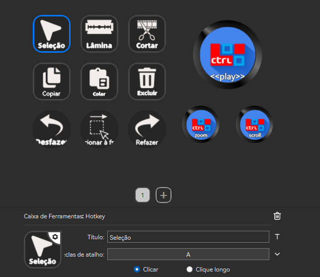

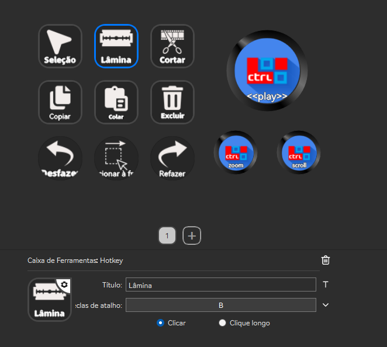

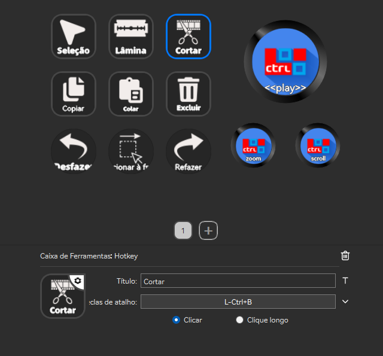

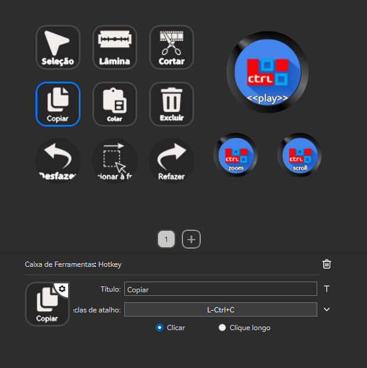

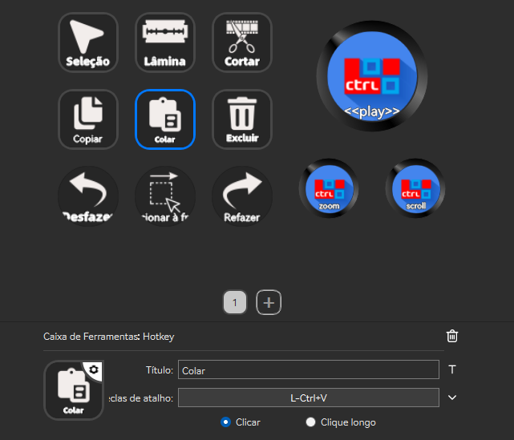

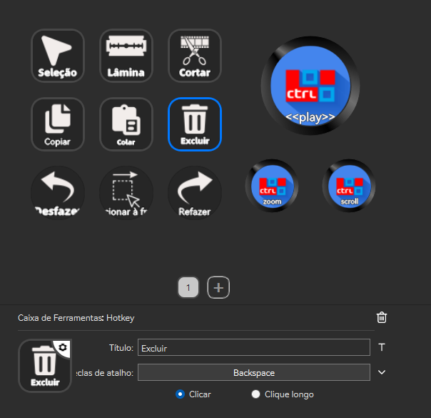

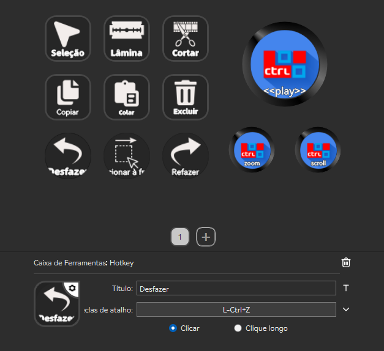

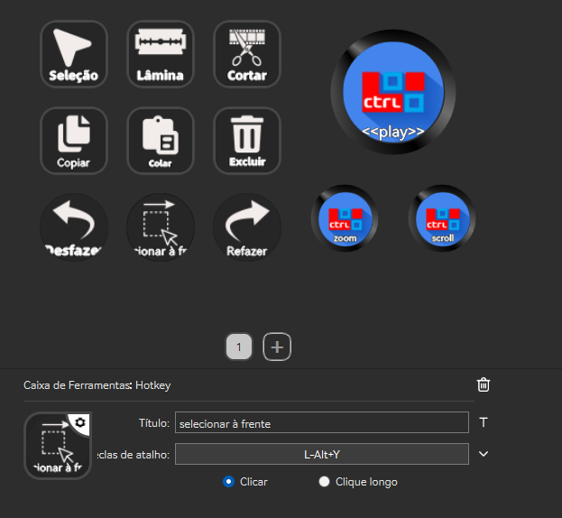

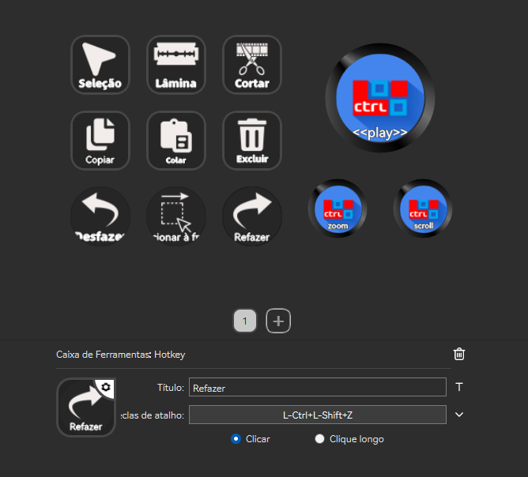

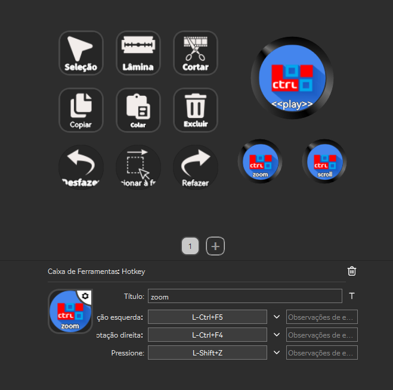

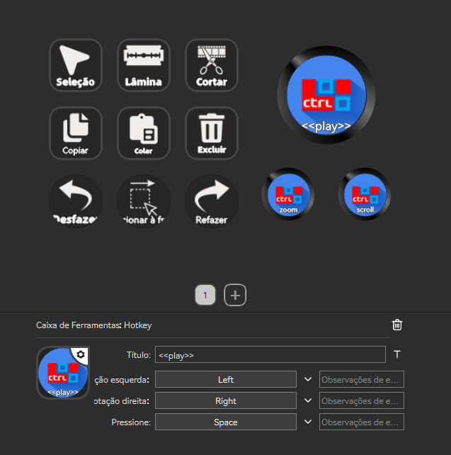

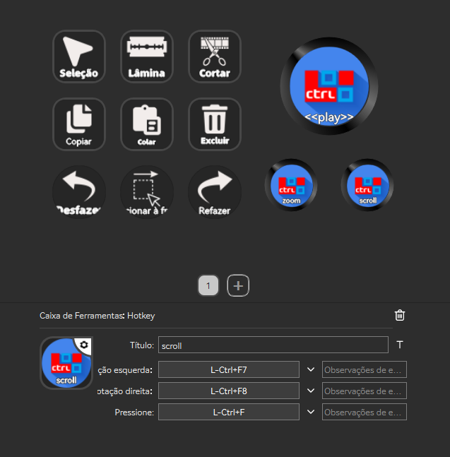
