# Deezer

[Download full installer package / Baixar pacote completo](../../AJAZZ_AKP03E_v1.1.zip) · [Installation / Instalação](../../INSTALL.md) · [Profile / Perfil](Profile.SDProfile)

Saved configuration / Configuração gravada. Not hardware-tested / Sem teste físico.

Local program associations and audio devices must be selected again after import. / Selecione novamente os aplicativos e dispositivos de áudio após importar.

## Controls / Controles

| Page / Página | Position / Posição | Label / Rótulo | Saved command / Comando salvo |
|---|---|---|---|
| root | 0,0 |  | {"actionIdx": 0} |
| root | 0,1 |  | Win+E  /  (empty)  /  (empty) |
| root | 1,0 |  | {"actionIdx": 1} |
| root | 1,1 |  | {"actionIdx": 3} |
| root | 2,0 |  | {"actionIdx": 2} |
| root | 2,1 |  | Machine-specific audio endpoints; reselect devices after import |
| root | 3,0 |  | {"actionIdx": 0} |
| root | 3,1 | L-Ctrl+F10 | Ctrl+F9  /  Ctrl+F10  /  Win+Up |
| root | 4,1 | F5 | Alt+Left  /  Alt+Right  /  F5 |
| root | 5,0 | desktop | Win+D  /  (empty)  /  (empty) |
| root | 5,1 | alternar | Win+Tab  /  (empty)  /  (empty) |
| root | 5,2 | minimizar | Win+Down  /  (empty)  /  (empty) |
| 6B55T0C5-0R0Q-7P26-ZODS-Y2GCZ10PKY42.sdProfile | 0,0 |  | {} |
| 6B55T0C5-0R0Q-7P26-ZODS-Y2GCZ10PKY42.sdProfile | 3,1 |  | {} |
| 76500I80-RZBG-DQQE-M67H-UB4SNT59NZ64.sdProfile | 0,0 |  | {} |
| 76500I80-RZBG-DQQE-M67H-UB4SNT59NZ64.sdProfile | 3,1 |  | {} |
| BH327S3X-07E0-740K-R0XP-P8QKG64851S6.sdProfile | 0,0 |  | {} |
| BH327S3X-07E0-740K-R0XP-P8QKG64851S6.sdProfile | 3,1 |  | {} |
| HQO44S61-1F8F-2UWY-7RIY-1PD1INI466B4.sdProfile | 0,0 |  | {} |
| HQO44S61-1F8F-2UWY-7RIY-1PD1INI466B4.sdProfile | 3,1 |  | {} |
| SX5N4VS5-Z9U3-K247-E89M-VZ66U7JF9822.sdProfile | 0,0 |  | {} |
| SX5N4VS5-Z9U3-K247-E89M-VZ66U7JF9822.sdProfile | 3,1 |  | {} |

## Screenshots / Capturas de tela

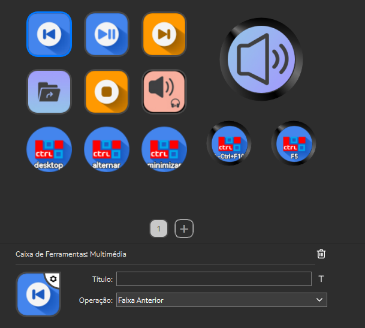

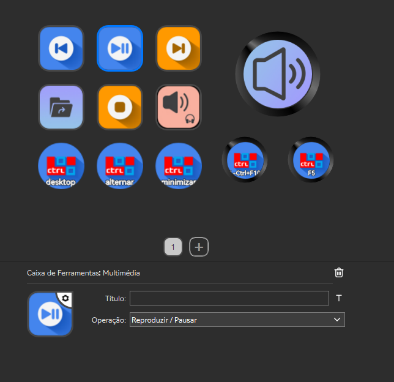

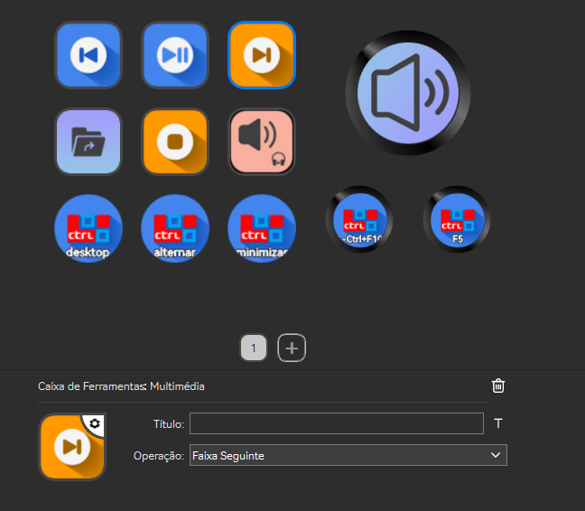

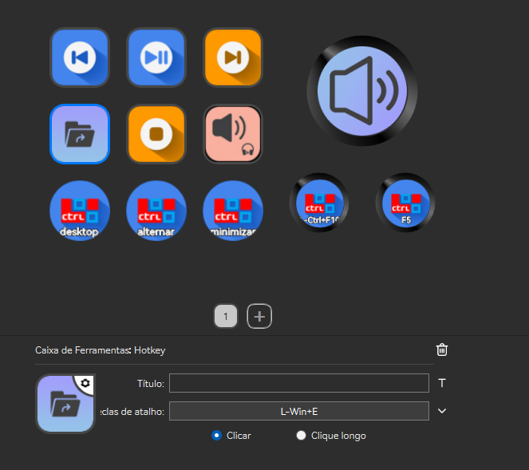

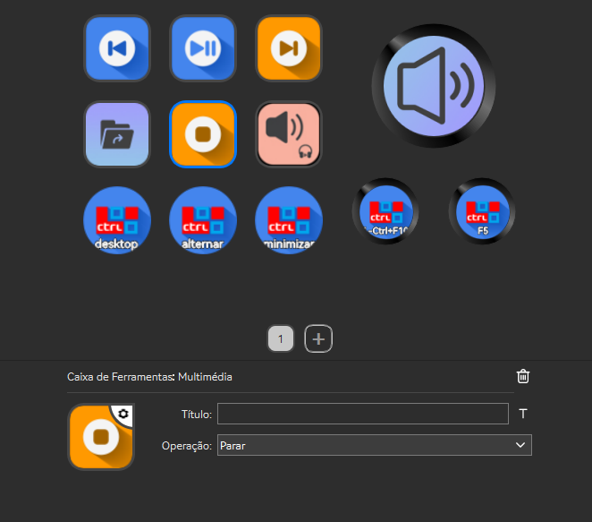

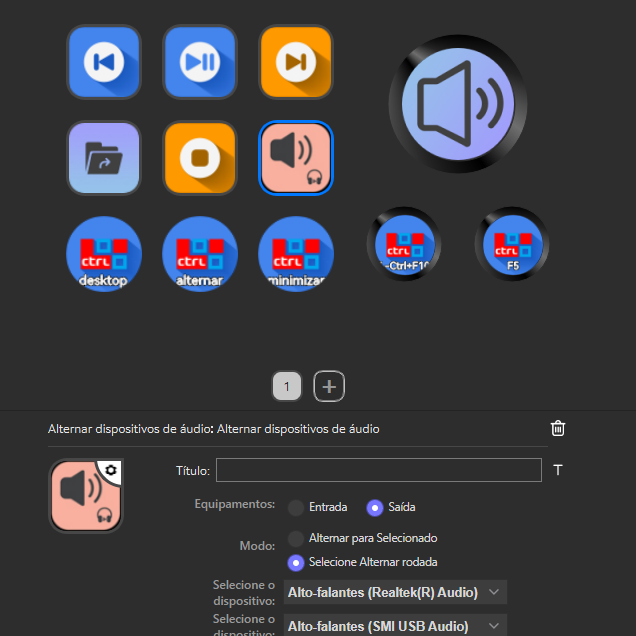

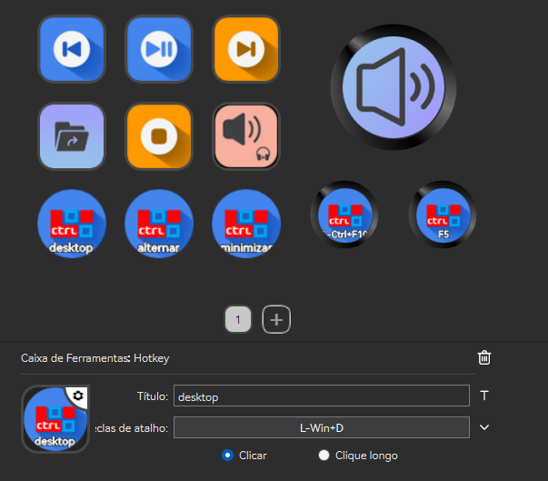

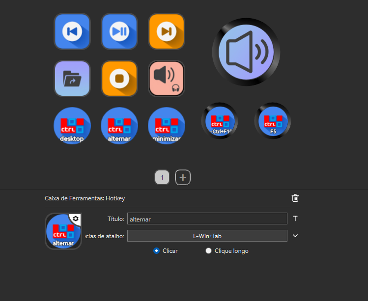

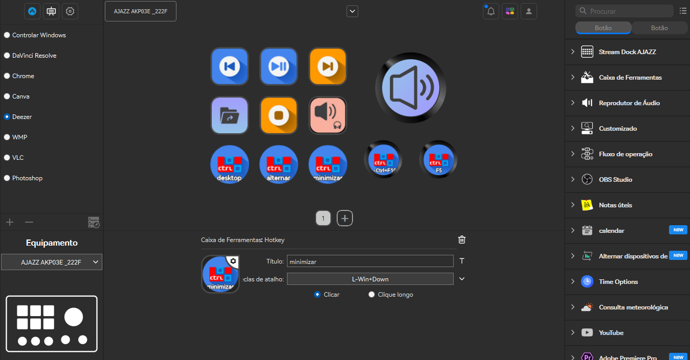

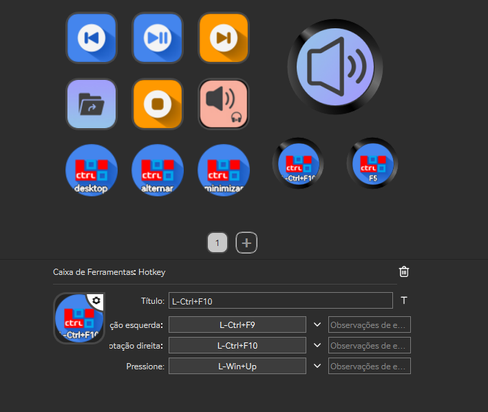

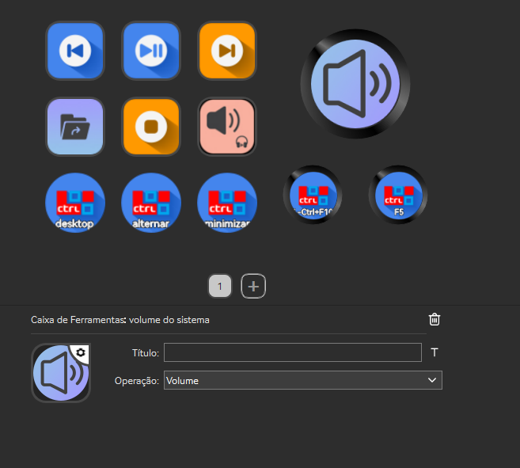

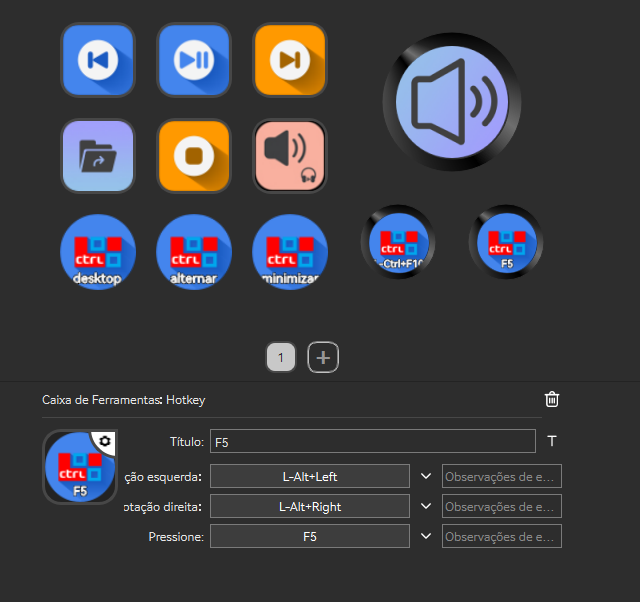
