# Controlar Windows

[Download full installer package / Baixar pacote completo](../../AJAZZ_AKP03E_v1.1.zip) · [Installation / Instalação](../../INSTALL.md) · [Profile / Perfil](Profile.SDProfile)

Saved configuration / Configuração gravada. Not hardware-tested / Sem teste físico.

Local program associations and audio devices must be selected again after import. / Selecione novamente os aplicativos e dispositivos de áudio após importar.

## Controls / Controles

| Page / Página | Position / Posição | Label / Rótulo | Saved command / Comando salvo |
|---|---|---|---|
| root | 0,0 | Voltar | Alt+Left  /  (empty)  /  (empty) |
| root | 0,1 |  | appId=51; zero-based candidate: DaVinci Resolve; target=D:\BlackMagic\Resolve.exe |
| root | 1,0 | Desktop | Win+D  /  (empty)  /  (empty) |
| root | 1,1 |  | appId=36; zero-based candidate: Canva; target=com.canva.CanvaDesktop |
| root | 2,0 | Fechar | Alt+F4  /  (empty)  /  (empty) |
| root | 2,1 |  | appId=74; zero-based candidate: Google Chrome; target=Chrome |
| root | 3,0 |  | {"actionIdx": 0} |
| root | 3,1 | Andar X | Left  /  Right  /  F |
| root | 4,1 |  | {} |
| root | 5,0 |  | appId=51; zero-based candidate: Deezer Music; target=Deezer.62021768415AF_q7m17pa7q8kj0!Deezer.Music |
| root | 5,1 |  | {"actionIdx": 1} |
| root | 5,2 |  | {"actionIdx": 2} |
| 9M94076G-412G-1489-CC41-8O9K6FC87K3Y.sdProfile | 0,0 | Tarefas | Ctrl+Alt+Delete  /  (empty)  /  (empty) |
| 9M94076G-412G-1489-CC41-8O9K6FC87K3Y.sdProfile | 0,1 | Configs. | (empty)  /  (empty)  /  (empty) |
| 9M94076G-412G-1489-CC41-8O9K6FC87K3Y.sdProfile | 1,0 | Reiniciar | {} |
| 9M94076G-412G-1489-CC41-8O9K6FC87K3Y.sdProfile | 1,1 | Dormir | {} |
| 9M94076G-412G-1489-CC41-8O9K6FC87K3Y.sdProfile | 2,0 | Desligar | {} |
| 9M94076G-412G-1489-CC41-8O9K6FC87K3Y.sdProfile | 2,1 | Logoff | {} |
| 9M94076G-412G-1489-CC41-8O9K6FC87K3Y.sdProfile | 3,0 | Rolar y | Ctrl+F1  /  Ctrl+F2  /  (empty) |
| 9M94076G-412G-1489-CC41-8O9K6FC87K3Y.sdProfile | 3,1 | Print Screen | Win+Num-  /  Win+Num+  /  PrintScreen |
| 9M94076G-412G-1489-CC41-8O9K6FC87K3Y.sdProfile | 4,1 |  | {} |
| 9M94076G-412G-1489-CC41-8O9K6FC87K3Y.sdProfile | 5,0 |  | appId=138; zero-based candidate: Stream Dock AJAZZ; target=D:\Program Files (x86)\AJAZZ\Stream Dock AJAZZ.exe |
| 9M94076G-412G-1489-CC41-8O9K6FC87K3Y.sdProfile | 5,1 | Drive Thálion | {"path": "F:/Drive Thálion"} |
| 9M94076G-412G-1489-CC41-8O9K6FC87K3Y.sdProfile | 5,2 | Família Urso | {"path": "F:/Família Urso"} |

## Screenshot chronology / Cronologia dos prints

These screenshots precede the latest corrected export. For current bindings use the table above: page 1 lower-left Left / Right / F; page 2 lower-left Magnifier / PrintScreen; page 2 main Ctrl+F1 / Ctrl+F2. / Estes prints são anteriores ao export corrigido. Para as atribuições atuais, consulte a tabela acima.

## Screenshots / Capturas de tela

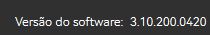

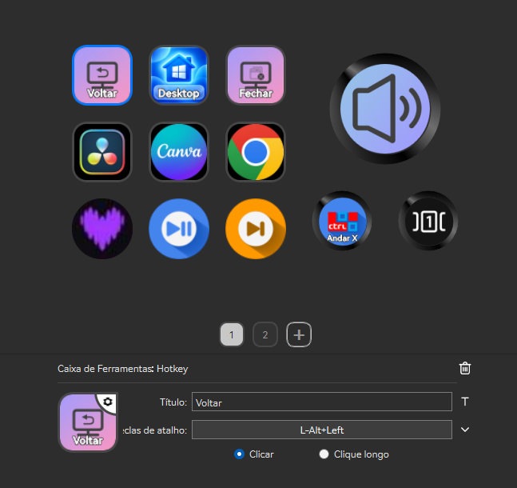

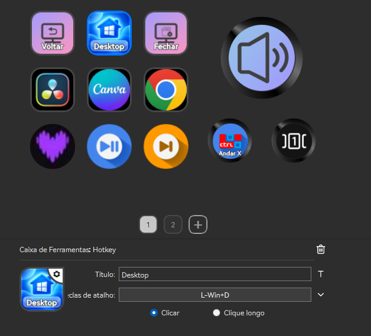

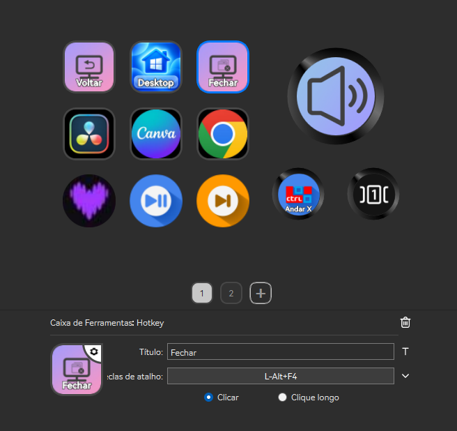

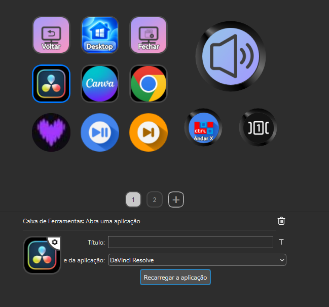

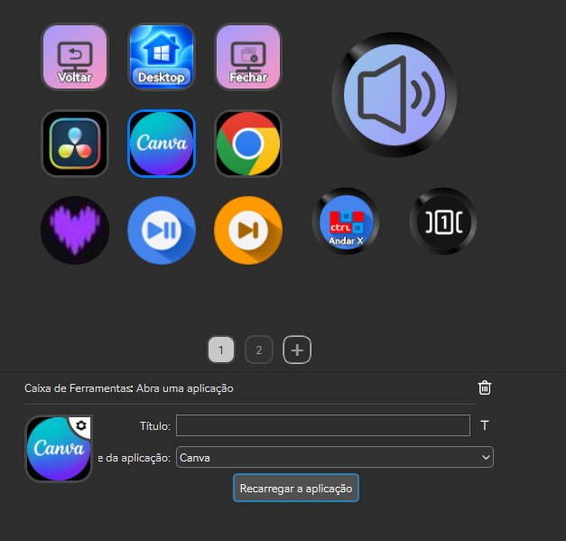

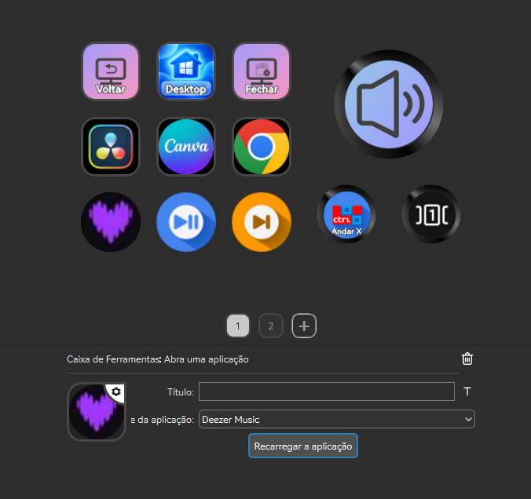

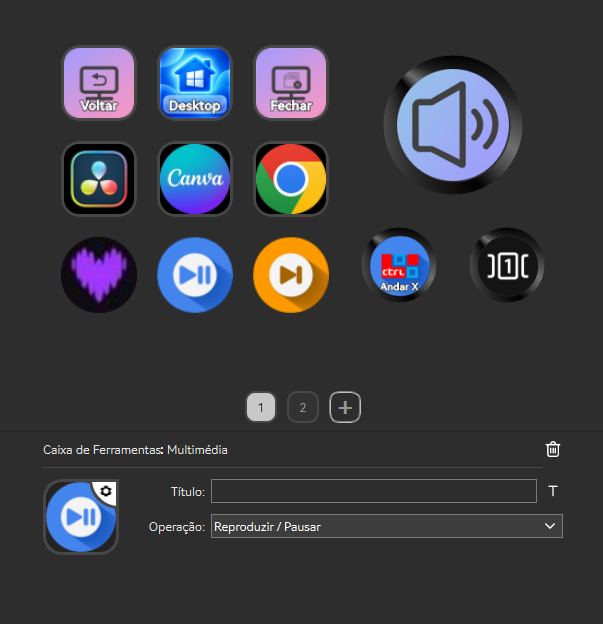

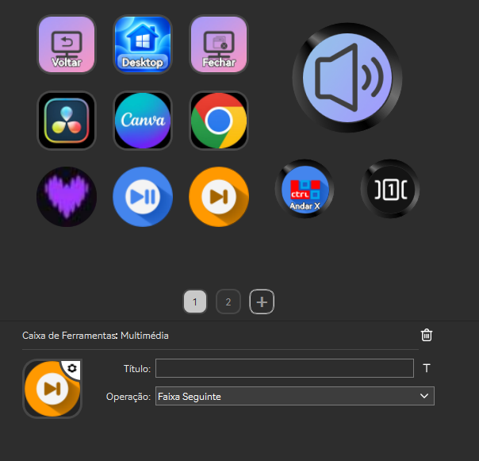

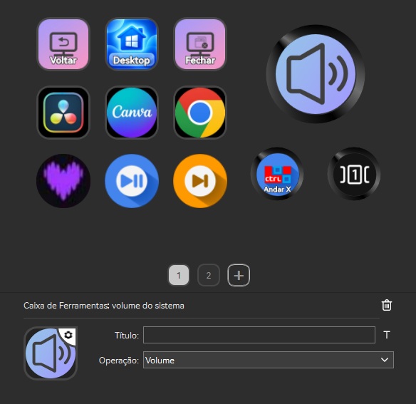

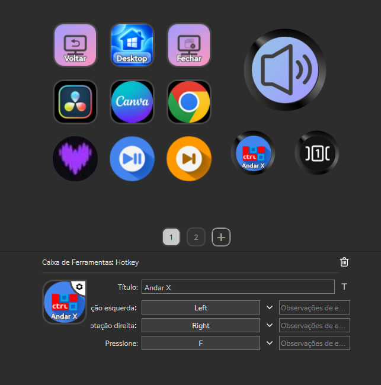

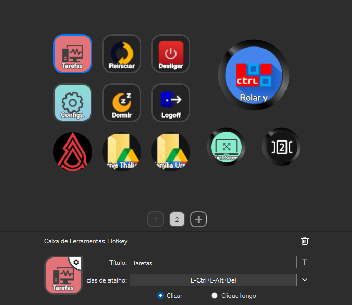

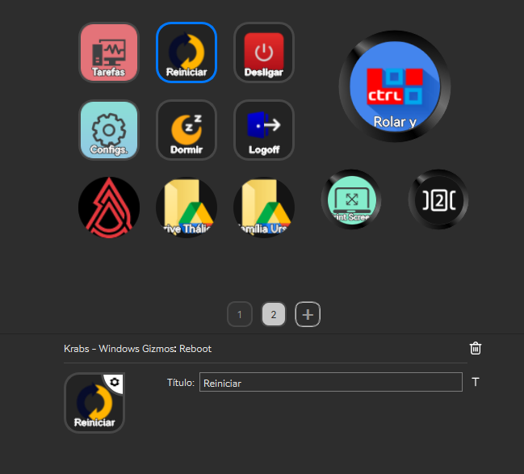

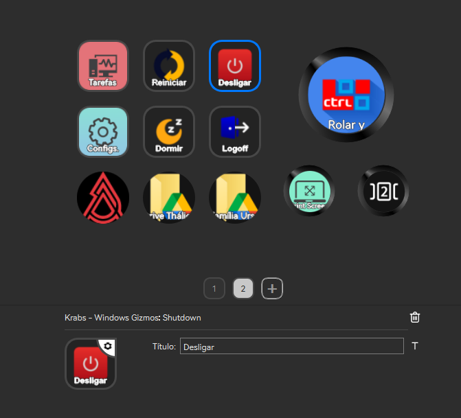

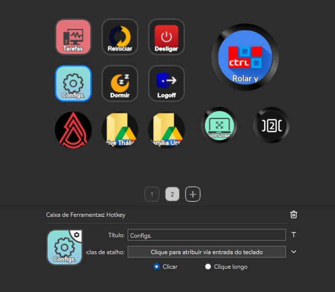

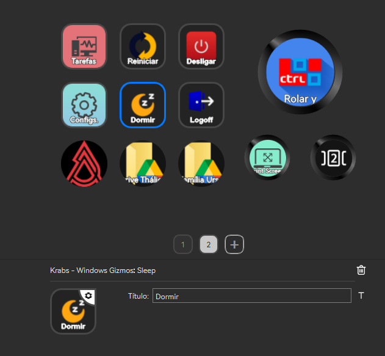

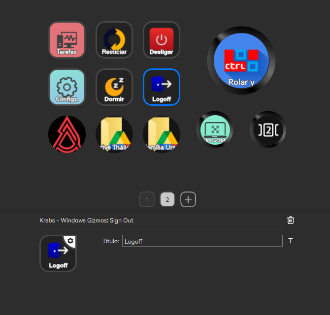

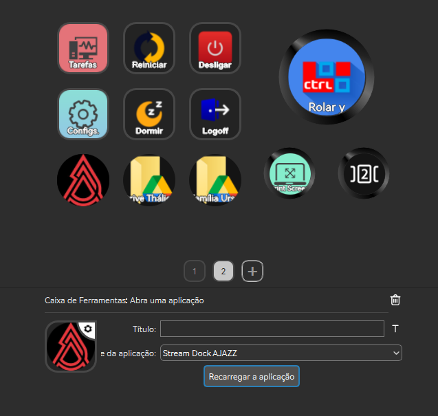

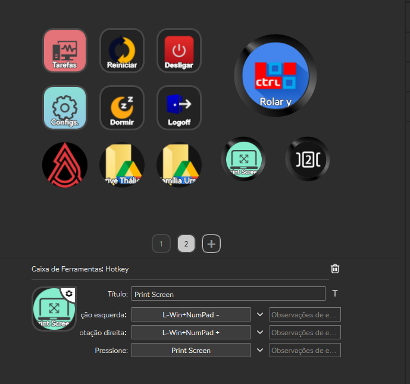

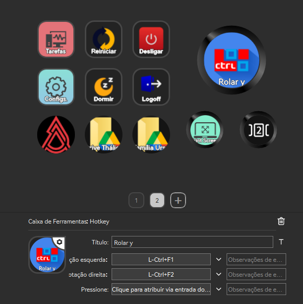
